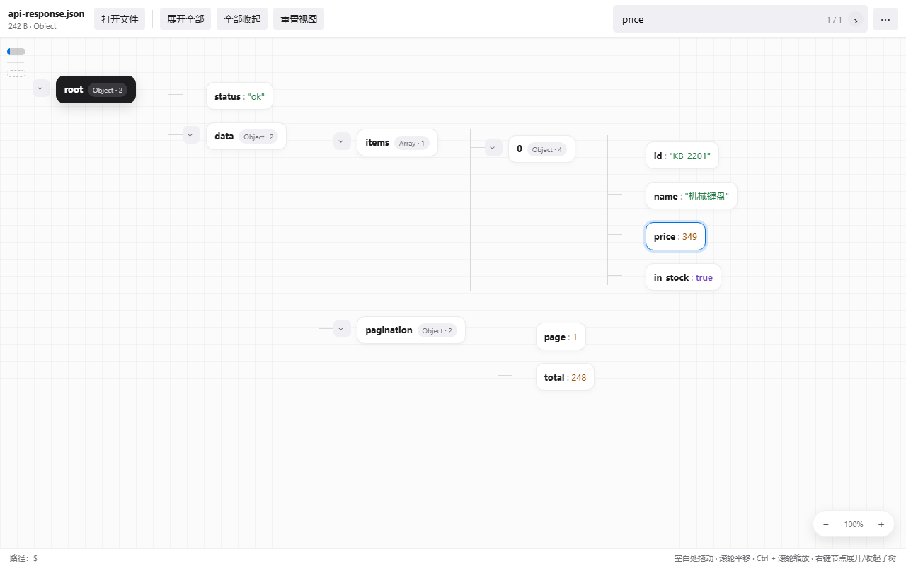

# JSON Atlas

**在可交互的树形画布中，看清 JSON 的每一层。**

本地 JSON / JSONL 阅读与编辑工具。展开接口响应、嵌套配置和逐行记录，搜索键名或值并定位到节点；需要修改原文时，切换到 IDE 文本视图。文件内容在本机处理，不上传。

Explore JSON and JSONL on an interactive tree canvas. Find fields, inspect nested data, and edit small files locally. Free and open source.

[](https://github.com/The-cute-cat/json-atlas/releases)
[](https://github.com/The-cute-cat/json-atlas/actions/workflows/ci.yml)
[](LICENSE)

[浏览器试用与项目介绍](https://the-cute-cat.github.io/json-atlas/) · [下载 Windows 安装包](https://github.com/The-cute-cat/json-atlas/releases/latest) · [反馈问题](https://github.com/The-cute-cat/json-atlas/issues)



### 适合用来做什么

- **读懂陌生结构**：逐层展开对象与数组，查看节点路径，隐藏无关字段。
- **定位关心的内容**：搜索键名或值，支持全词、常用正则与选中分支范围搜索。
- **查看 JSONL 记录**：直接打开逐行数据，无需先转换为 JSON 数组。
- **修改小文件**：节点编辑与 IDE 文本视图共用内容和撤销；支持格式化、保存与另存为。

### 选择版本

| | Windows 桌面版 | 浏览器版 |
| --- | --- | --- |
| 用途 | 日常本地文件阅读与编辑 | 免安装试用，先从小文件开始 |
| 文件处理 | 超过阈值时建立磁盘索引，按页读取 | 整份解析到内存，单文件上限 256 MiB |
| 保存 | 写回原文件或另存为 | 下载修改副本 |
| 大文件编辑 | 磁盘索引模式只读 | IDE 视图有字符数、行数与结构复杂度限制 |

在线版首次打开需加载站点资源，文件内容在浏览器中处理。试用页可另存为单个 HTML 离线运行；浏览器限制可能影响后台任务。大文件建议使用桌面版，首次索引耗时取决于数据与设备。

当前代码版本 **0.3.0**。已发布版本以 [Releases](https://github.com/The-cute-cat/json-atlas/releases) 为准；改动见 [更新记录](CHANGELOG.md)，开发与构建说明见 [贡献指南](CONTRIBUTING.md)。

## 下载与安装

- 系统要求：Windows 10 / 11（64 位）。界面依赖 Microsoft Edge WebView2 运行时（Windows 11 与较新的 Windows 10 已自带）。
- 从 [Releases](https://github.com/The-cute-cat/json-atlas/releases) 下载所需版本的 `*-setup.exe` 或 `.msi`，选择一种安装即可。
- 支持关联 `.json`、`.jsonl`、`.ndjson`、`.jsonlines`。EXE 安装时可选择关联，MSI 会注册这些文件类型；如系统已有默认应用，可在 Windows 的“打开方式”中选择 JSON Atlas。
- 免安装试用：[打开浏览器版](https://the-cute-cat.github.io/json-atlas/app.html)。浏览器版与桌面版共用阅读界面，不提供原生磁盘索引与文件关联。
- 从 EXE 切换到 MSI 时，先卸载旧安装方式，再安装新包。MSI 保留对原有文件类型标识的兼容；如果 Windows 已将格式设为其他应用，请在“设置 → 应用 → 默认应用 → JSON Atlas”中确认默认打开方式。
- MSI 普通及静默卸载自动清除当前用户的本地设置、阅读历史与缓存，不再询问；升级不会清理。清除不可撤销，不会删除应用数据目录之外的 JSON / JSONL 文件。其他 Windows 用户的数据不在清理范围内。

## 快速上手

1. 拖入文件、使用“文件 → 打开文件…”（Ctrl+O），或双击已关联的 JSON / JSONL 文件。
2. 点击节点旁的箭头展开；在空白处拖动或滚动滚轮平移，按住 Ctrl 配合滚轮缩放。小文件直接在内存中读取，大文件按页加载。
3. 按 Ctrl+F 或选择“查看 → 查找…”打开高级查找，定位到匹配的节点。
4. 打开的多个文件组成工作区，可在侧栏切换；同名文件按完整路径区分。

在主页或画布空白处按 Ctrl/⌘+V，即可把剪贴板中的 JSON / JSONL 文本打开为左侧的临时文件。直接使用本次粘贴事件携带的文本，不主动读取剪贴板，也不会触发剪贴板读取授权窗口。搜索框、IDE 和其他输入框保留普通粘贴行为。

临时文件首次打开即标记为未保存。桌面版首次保存时选择位置，成功后会显示实际文件名并关联该路径，后续保存写回此文件；取消或保存失败时仍保留临时状态。浏览器版保存只下载副本，无法获取下载文件的本地位置。尚未保存的桌面临时文件不会加入重启恢复列表，关闭或退出时会提示。

桌面版仅接受本地磁盘路径，不支持 UNC 共享路径或映射的网络磁盘；请先把需要阅读的文件复制到本地。取消加载会停止当前批次中尚未打开的文件。

## 功能

- **阅读**：导图式展开、平移、缩放；长字段先显示预览，需要时再读取全文。
- **编辑**：小文件支持节点编辑、IDE 文本编辑、格式化、撤销、保存与另存为；大文件索引模式保持只读。
- **查找**：区分大小写、Unicode 全词、常用正则，可限定在当前选中节点范围内；结果支持双向循环跳转。
- **整理**：隐藏无关字段、套用展开模板、把字符串里的内嵌 JSON 作为子树展开。
- **大文件**：超过阈值的文件在后台建立磁盘索引，展开和搜索时按需读取；扫描与搜索都可以取消。
- **会话**：文件切换时保留实际展开的数组条目，可选择在重启后恢复上次的阅读状态。
- **隐私**：文件内容不上传，解析、索引与搜索在本机完成。

设置使用左侧分类、右侧选项的两栏界面，修改自动保存；左侧分类支持方向键、Home 和 End 切换。

## IDE 查看方式

在“设置 → 阅读与布局 → IDE 折叠箭头常驻显示”选择是否始终显示折叠图标，默认关闭，鼠标移到行号区域时即时显示；键盘聚焦折叠按钮时也会显示。已折叠节点的箭头始终显示，折叠行有整行底色；光标所在行、配对括号及当前层级引导线会显示定位提示。细线图标随字号缩放，显示与悬停均无动画；点击可折叠或展开对象与数组。折叠只影响显示，保存、格式化和搜索仍使用完整内容。搜索定位会展开折叠区域；跨越折叠内容的删除会先展开，避免误删隐藏字段。

在“设置 → 阅读与布局 → 外观主题”选择白天、夜间或跟随系统。默认跟随系统，并实时响应系统外观变化；手动选择会保存在本机设置中。

在“设置 → 阅读与布局 → 文件查看方式”选择“简单结构自动使用 IDE”或“优先使用 IDE”，即可用带行号、语法高亮的代码视图阅读。默认仍为树形视图；桌面版通过顶部“查看”菜单临时切换当前文件，浏览器预览通过“⋯”菜单切换。两种视图共用修改后的内容、撤销与查找结果，IDE 中的搜索会跳到对应行。

IDE 视图默认可以直接编辑原文，包括修改键名、新增和删除字段。修改先保留在工作副本中，通过“文件 → 保存”（Ctrl/⌘+S）写回当前文件，或“文件 → 另存为…”（Ctrl/⌘+Shift+S）导出副本。输入期间可以暂时存在语法错误，错误草稿在切换文件后仍会保留；修正后才能切到树形视图或保存。两种视图共用最近 10 步撤销，IDE 内可按 Ctrl/⌘+Z 撤销。

选择“编辑 → 格式化文档”（浏览器预览在“⋯”菜单中），或按 Shift+Alt+F：JSON 使用两空格缩进；JSONL 整理为每行一条记录，所有记录都会显示，不受树形视图“首条记录”选项影响。格式化会校验完整内容，遇到错误或注释行会提示，不会跳过或删除错误行；格式化也可以撤销。

IDE 内按 Ctrl/⌘ 加 `+` / `-` 放大或缩小字号，Ctrl/⌘+0 恢复默认；也支持按住 Ctrl/⌘ 滚动滚轮。括号按嵌套层级着色，配合细虚线结构引导线阅读；字符串内的括号不参与配色。缩放仅影响代码显示，不修改内容。

超过设置的内存阈值或已建立磁盘索引的文件始终使用树形视图。自动模式适用于最多 2000 个值、12 层嵌套的结构；优先 IDE 放宽到 10000 个值、64 层。两者均限制为约 200 万字符、20000 行，超过后自动回退到树形视图，避免复杂文件拖慢界面。

## 键盘快捷键

常用操作参考 [IDEA Windows 键位](https://www.jetbrains.com/help/idea/reference-keymap-win-default.html)与 [macOS 键位](https://www.jetbrains.com/help/idea/reference-keymap-mac-default.html)，按阅读器已有功能适配。“设置 → 键盘快捷键”、按钮提示与底部说明会按系统显示 Ctrl 或 ⌘。

| 操作 | Windows / Linux | macOS |
| --- | --- | --- |
| 复制选中节点内容（树形视图） | Ctrl+C | ⌘+C |
| 保存 | Ctrl+S | ⌘+S |
| 另存为副本 | Ctrl+Shift+S | ⌘+Shift+S |
| 撤销修改 | Ctrl+Z | ⌘+Z |
| 打开文件 | Ctrl+O | ⌘+O |
| 关闭当前文件 | Ctrl+F4 | ⌘+W |
| 查找 | Ctrl+F | ⌘+F |
| 下一个 / 上一个匹配 | F3 / Shift+F3 | ⌘+G / ⌘+Shift+G |
| 格式化 IDE 文档 | Ctrl+Alt+L | ⌘+⌥+L |
| 设置 | Ctrl+Alt+S | ⌘+, |
| 切换树形 / IDE 视图（自定义） | Ctrl+Alt+V | ⌘+⌥+V |
| 切换树形编辑模式（自定义） | Ctrl+Alt+E | ⌘+⌥+E |
| 重置视图 / IDE 字号（自定义） | Ctrl+Alt+0 | ⌘+⌥+0 |
| 关于 JSON Atlas | F1 | F1 |
| 展开全部 / 当前页 | Ctrl+Shift+小键盘 + | ⌘+Shift+小键盘 + |
| 全部收起 | Ctrl+Shift+小键盘 − | ⌘+Shift+小键盘 − |
| 下一个 / 上一个文件 | Alt+→ / Alt+← | ⌘+Shift+] / ⌘+Shift+[ |

展开和收起只作用于树形视图，仍遵守分页和显示节点数量限制。普通输入框保留自身的文字撤销和光标移动；弹窗开启或输入法正在组字时，不执行上述文档操作。原有 Shift+Alt+F 格式化与 Ctrl+W 在非输入区域关闭文件的操作仍可使用。

## 修改节点

单击树形节点卡片选中后，按 Ctrl/⌘+C 复制节点内容，与右键“复制节点内容”一致：对象和数组为格式化 JSON，字符串为不带外层引号的文本。“设置 → 阅读与布局 → 显示节点选中描边”默认关闭，开启后为选中节点显示描边；关闭不影响复制。点击画布空白处取消选择。输入框、IDE 和已有文字选区保留原有复制行为。

右键菜单中的“复制路径”会复制该节点的完整 JSON 路径，例如 `$.records[0].metadata`；特殊字段名使用方括号表示。展开一级可直接点击节点旁的箭头。

右键点击节点并选择“编辑节点…”，修改字符串、数字、布尔值、null、对象或数组。字符串直接输入文本，其他类型需填写合法 JSON，也可以通过类型选择器改变值的类型。

桌面版通过顶部“编辑 → 编辑模式”开启后，点击卡片即可编辑，“编辑 → 撤销修改”支持最近 10 步撤销；浏览器预览通过“⋯”菜单操作。设置中的“Vim 风格编辑快捷键”默认关闭；开启后，在画布空白处点击取得焦点，按小写 i 进入编辑模式，按 Esc 退出。搜索框、编辑弹窗和其他输入控件不会触发这些快捷键。

修改先保存在工作副本中。桌面版按 Ctrl/⌘+S 或选择“文件 → 保存”写回当前文件；如果原文件已被其他程序修改，会停止保存并提示重新打开或另存为。保存后仍可撤销，撤销产生的修改需要再次保存。“另存为…”会弹出保存位置选择窗口，导出不同名称的副本。关闭尚未保存的文件或退出应用会提示确认。浏览器预览的保存会下载修改副本。

JSONL 节点编辑后的文本仅保留有效记录，不保留注释、空白行及被跳过的坏行。如果加载时跳过了有问题的行，直接保存会提示使用“另存为”，避免覆盖原始记录。

树形视图的编辑弹窗仅支持内存模式的节点值编辑；字段重命名、新增及删除可在 IDE 中修改文本完成。磁盘索引大文件和字符串中展开的虚拟 JSON 节点保持只读。

## 查找

工具栏上有固定的搜索框。按 Ctrl+F 或选择“查看 → 查找…”打开高级查找浮窗：拖动左侧手柄可移动，点击图钉可锁定位置；位置和锁定状态会被记住，缩小窗口时自动移回可见区域。浮窗每次启动默认关闭。

浮窗内 `Aa` 切换大小写，`ab` 切换全词，`.*` 切换正则。Enter / Shift+Enter 或上下箭头在结果间循环，F3 / Shift+F3 同样可用。Esc 或右上角 × 关闭浮窗并保留结果；输入框旁的 × 清除搜索。在顶部搜索框输入新内容会恢复普通搜索，空格作为查询内容保留。

先点击树中的节点，再开启 `≡`，即只在该节点及其下级内容中查找，范围按钮的提示会显示对应路径。文件切换或清除搜索会退出范围限制。被隐藏的字段继续排除，最多列出前 1000 个匹配节点。

正则支持分组、字符组、重复、锚点与 Unicode 属性；暂不支持环视和反向引用，错误会显示在查找栏下方。复杂表达式长时间无法完成时，请简化表达式或缩小查找范围。

## 大文件与已知限制

- 设置（“查看 → 设置…”）中可把大文件阈值设为 32 / 64 / 128 / 256 MB，默认 64 MB（1 MB = 1024 × 1024 字节）。超过阈值的文件不再整份读入内存，而是后台扫描并建立临时磁盘索引，关闭文件时删除。
- 索引模式：单个分支每页 100 项；页面缓存有固定预算，优先保留已显示的页面；搜索最多返回 1000 条匹配，改换查询或关闭文档会取消后台搜索。
- 小文件支持“展开全部 / 展开全部下级”。为保护界面，画布显示约 5000 个节点时会暂停继续展开；可点击“精简远处节点”保留当前阅读区域并释放远处内容，或收起部分分支后继续。
- 长字段只显示预览，单次全文读取或复制上限 8 MiB；查找不受此限制。
- 索引模式不支持超过 128 层的 JSON 嵌套，以及超过 64 KiB 的字段名。
- 目前只提供 Windows 安装包。浏览器版单文件上限 256 MiB，整份文件仍需载入内存；这不是流畅运行的大小保证。离线单文件版与站点可分别通过 `npm run build:single` 和 `npm run build:site` 生成。

## 开发

开发环境、构建、测试和贡献说明见 [贡献指南](CONTRIBUTING.md)。最短启动流程：

```powershell
git clone https://github.com/The-cute-cat/json-atlas.git
cd json-atlas
npm ci
npm run desktop:dev
```

欢迎通过 [Issues](https://github.com/The-cute-cat/json-atlas/issues) 报告问题和提出建议。请提供版本、操作步骤和脱敏后的最小样例，避免提交真实业务文件或个人信息。

## 许可

JSON Atlas 使用 Apache-2.0 许可证，见 [LICENSE](LICENSE)。版权所有 (c) 2026 The_cute_cat 和其他贡献者。
