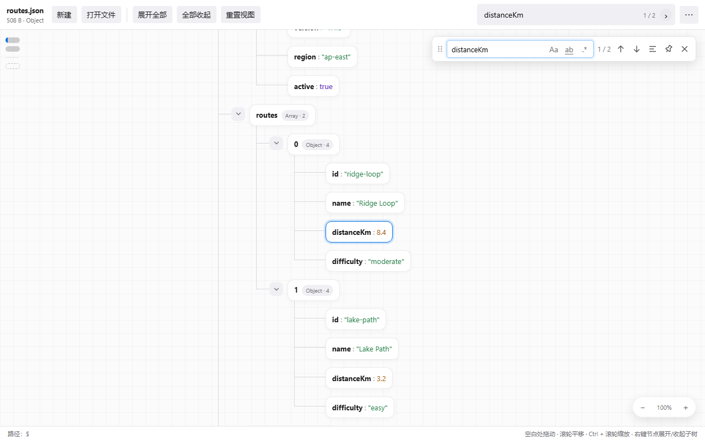

# JSON Atlas

[English](README.md) · [简体中文](docs/README.zh-CN.md) · [日本語](docs/README.ja.md) · [Español](docs/README.es.md) · [Français](docs/README.fr.md)

**Open just the JSON branches you want to read.**

JSON Atlas is a free, open-source reader and editor for local JSON, JSONL, and NDJSON files. Expand nested data, find fields by key or value, and edit the source in the IDE view. The app parses, indexes, and searches file contents locally; nothing is uploaded.

[Project site](https://the-cute-cat.github.io/json-atlas/) · [Try in your browser](https://the-cute-cat.github.io/json-atlas/app.html) · [Download for Windows](https://github.com/The-cute-cat/json-atlas/releases) · [Report an issue](https://github.com/The-cute-cat/json-atlas/issues/new/choose)

Current code version **0.5.0-beta.1**. Published builds are listed on [Releases](https://github.com/The-cute-cat/json-atlas/releases); changes are tracked in the [changelog](CHANGELOG.md) and build instructions in the [contribution guide](CONTRIBUTING.md).

On first launch, the interface uses the first supported language in your preferred language list. English and Simplified Chinese are supported, with English as the fallback. To change the saved choice, use **Settings → Appearance and view → Interface language** (`设置 → 外观与视图 → 界面语言`), then reopen the app or refresh the page.

### Why I built it

I often opened a JSON file looking for one field and found branches I didn't need taking up most of the screen. The deeper the nesting, the harder it was to follow the branch I cared about. I built JSON Atlas so I could open that branch one level at a time and leave the rest collapsed.

### What it's for

- **Understand unfamiliar structures:** expand objects and arrays level by level, inspect node paths, and hide fields you don't need.
- **Find what matters:** search keys or values with case sensitivity, whole words, common regular expressions, and a selected-branch scope.
- **Read JSONL directly:** open line-delimited records without converting them to a JSON array first.
- **Edit small files:** tree editing and the IDE text view share the same content and undo history, with formatting, save, and Save As.

### Choose an edition

| | Windows desktop | Browser |
| --- | --- | --- |
| Best for | Everyday local reading and editing | Try it without installing; start with small files |
| File handling | Builds a disk index above the threshold and reads in pages | Parses in memory below the threshold and refuses larger files |
| Saving | Writes back to the original file or saves a copy | Downloads an edited copy |
| Large-file editing | Indexed mode is read-only | The IDE has limits on structure and text size |

The browser edition loads site resources on first visit but processes file content in your browser. The standalone HTML version can be saved and run offline; browser limits may affect background work. Use the desktop app for large files — first indexing time depends on the data and device.

## Install

The [Releases page](https://github.com/The-cute-cat/json-atlas/releases) includes stable builds and pre-releases. Pre-release Windows builds provide an EXE installer and a portable ZIP. Stable builds also provide an MSI.

The desktop app checks GitHub Releases daily for new stable versions. **Check for updates** (`检查更新…`) opens a dialog where you can see the result or turn off automatic checks.

| Edition | Requirements and setup |
| --- | --- |
| Windows desktop | Windows 10 or 11 (64-bit) and Microsoft Edge WebView2. Choose the EXE or MSI installer from [Releases](https://github.com/The-cute-cat/json-atlas/releases). A portable package is also available and requires WebView2. |
| Browser | Open the [browser app](https://the-cute-cat.github.io/json-atlas/app.html). The standalone HTML version can run offline. Saving downloads an edited copy. |
| macOS preview | Apple silicon and macOS 15 or later. Sign in to GitHub and download the artifact from a successful [preview workflow run](https://github.com/The-cute-cat/json-atlas/actions/workflows/macos-preview.yml). Open the DMG and drag the app into Applications. Gatekeeper may block the preview because it is not notarized. |

If the app reports a missing WebView2 Runtime, install the Evergreen Runtime and try again. [Download WebView2 from Microsoft](https://developer.microsoft.com/en-us/microsoft-edge/webview2/#download).

The Windows installers can associate `.json`, `.jsonl`, `.ndjson`, and `.jsonlines` files. The EXE installer offers a choice, while the MSI registers these types. To switch from EXE to MSI, uninstall the EXE installation first; the MSI keeps compatibility with the existing file-type identifier. If another app is set as the default, choose JSON Atlas under Windows *Settings → Apps → Default apps*. MSI uninstallation clears the current user's local settings, reading history, and cache without prompting; upgrades preserve them. Only app-specific directories are cleared, and other Windows users' data is untouched.

The macOS preview is temporary-signed and not notarized; uninstall it by moving the app to Trash. User data under `~/Library/Application Support/io.hopecat.jsonatlas` and `~/Library/Caches/io.hopecat.jsonatlas` may remain.

## Quick start

1. Drop a file onto the app, open it with Ctrl/⌘+O, or double-click an associated JSON / JSONL file. JSONL opens directly as one record per line.
2. Click a node's arrow to expand it. Drag the background or scroll to pan; hold Ctrl/⌘ while scrolling to zoom. Small files are parsed in memory; large files load in pages.
3. Press Ctrl/⌘+F for advanced search. Switch between open files in the sidebar; the desktop app distinguishes same-named files by their full local paths.
4. Press Ctrl/⌘+N to create a blank JSON document. Select an object or array and click **+** to add a child or an array item. Applied edits in newly created documents are saved as drafts and can be restored after restart; saving or explicitly discarding a draft clears it.

Paste JSON or JSONL onto the canvas with Ctrl/⌘+V to open a temporary document. The app uses the text from that paste event directly — it does not read the clipboard or trigger a clipboard permission prompt. Search boxes, the IDE, and other inputs keep their normal paste behavior. A pasted document starts unsaved; the first successful desktop save asks for a location, shows the actual filename, and associates the path. Canceling or a failed save leaves it temporary. The browser edition can only download a copy and cannot learn the downloaded file's location. Unsaved pasted documents are excluded from desktop restart recovery, and the app prompts before closing or quitting.

The desktop app accepts local paths only. Copy files from UNC shares or mapped network drives to local storage before opening them.

## Features

- **Reading:** mind-map-style expansion, pan and zoom, and previews for long fields with on-demand full text.
- **Editing:** tree node editing, IDE text editing, formatting, undo, save, and Save As for small files; indexed large files stay read-only.
- **Finding:** case-sensitive, Unicode whole-word, and common regular-expression search with an optional selected-node scope and two-way result navigation.
- **Organizing:** hide fields, reuse expansion templates, and open JSON embedded in strings as virtual subtrees.
- **Large files:** background disk indexing above the threshold, with on-demand page reads and cancellable scans and searches.
- **Sessions:** preserve the exact expanded array items when switching files and optionally restore the last reading state on restart.
- **Privacy:** file content is never uploaded; parsing, indexing, and search run locally.

Settings use a two-column layout with categories on the left and options on the right, saved automatically. The category list supports arrow keys, Home, and End.

## IDE view

In **Settings → Appearance and view → Keep IDE fold arrows visible** (`设置 → 外观与视图 → IDE 折叠箭头常驻显示`), choose whether fold icons are always shown (off by default; they appear on hover over the line-number area and when keyboard-focused). Folded nodes keep their arrows and a shaded row; the cursor line, matching brackets, and the current nesting guide are highlighted. Icons scale with the font size and have no hover animation. Folding affects display only — saving, formatting, and search use the full content. Search expands folded matches, and a deletion spanning folded content expands it first to avoid removing hidden fields.

In **Settings → Appearance and view → Appearance theme** (`设置 → 外观与视图 → 外观主题`), choose light, dark, or follow system (the default). Manual choices are saved locally.

In **Settings → Appearance and view → File view mode** (`设置 → 外观与视图 → 文件查看方式`), choose *simple structures use the IDE automatically* or *prefer the IDE*. The tree remains the default view; the desktop **View** menu and the browser **⋯** menu can switch the current file temporarily. Both views share content, edits, and search results, and IDE search jumps to the matching line.

The IDE edits source text directly, including renaming keys and adding or deleting fields. Changes stay in a working copy until **File → Save** (`文件 → 保存`) (Ctrl/⌘+S) writes them back or **File → Save As** (`文件 → 另存为…`) (Ctrl/⌘+Shift+S) exports a copy. Syntax errors may exist temporarily in the draft and survive a file switch; fix them before switching to the tree view or saving. Both views share undo history of up to 50 steps; larger documents reduce it by snapshot size to a minimum of 10 steps. The IDE groups consecutive typing into one step. Undo with Ctrl/⌘+Z and redo with Ctrl/⌘+Shift+Z.

Choose **Edit → Format document** (`编辑 → 格式化文档`) (or **⋯** in the browser), or press Ctrl+Alt+L / ⌘+⌥+L: JSON uses two-space indentation; JSONL becomes one record per line with all records shown, regardless of the tree's first-record option. Formatting validates the whole document and reports errors or comment lines instead of skipping or deleting them; it can be undone.

In the IDE, press Ctrl/⌘ with `+` / `-` to change the font size and Ctrl/⌘+0 to reset, or hold Ctrl/⌘ while scrolling. Brackets are colored by nesting depth with dotted structure guides; brackets inside strings are excluded. Zoom affects display only, not content.

Files above the memory threshold or already disk-indexed always use the tree view. Automatic mode applies to structures with up to 2,000 values and 12 levels; prefer-IDE raises this to 10,000 values and 64 levels. Both cap at about 2 million characters and 20,000 lines, falling back to the tree beyond that. Turning off **Limit IDE for complex files** lets you use the IDE manually for complex files within the threshold.

## Keyboard shortcuts

Common actions adapt the [IDEA Windows keymap](https://www.jetbrains.com/help/idea/reference-keymap-win-default.html) and [macOS keymap](https://www.jetbrains.com/help/idea/reference-keymap-mac-default.html). **Settings → Keyboard and menus** (`设置 → 键盘与菜单`), button tooltips, and footer hints show Ctrl or ⌘ according to your system.

| Action | Windows / Linux | macOS |
| --- | --- | --- |
| Copy selected node content (tree view) | Ctrl+C | ⌘+C |
| Save | Ctrl+S | ⌘+S |
| Save As a copy | Ctrl+Shift+S | ⌘+Shift+S |
| Undo / Redo | Ctrl+Z / Ctrl+Shift+Z (or Ctrl+Y) | ⌘+Z / ⌘+Shift+Z |
| New blank document | Ctrl+N | ⌘+N |
| Open file | Ctrl+O | ⌘+O |
| Close current file | Ctrl+F4 | ⌘+W |
| Find | Ctrl+F | ⌘+F |
| Next / previous match | F3 / Shift+F3 | ⌘+G / ⌘+Shift+G |
| Format IDE document | Ctrl+Alt+L | ⌘+⌥+L |
| Settings | Ctrl+Alt+S | ⌘+, |
| Switch tree / IDE view (customizable) | Ctrl+Alt+V or Ctrl+Shift+F6 | ⌘+⌥+V |
| Switch tree edit mode (customizable) | Ctrl+Alt+E or Ctrl+Shift+E | ⌘+⌥+E |
| Reset view / IDE font size (customizable) | Ctrl+Alt+0 | ⌘+⌥+0 |
| About JSON Atlas | F1 | F1 |
| Expand all / current page | Ctrl+Shift+Numpad + | ⌘+Shift+Numpad + |
| Collapse all | Ctrl+Shift+Numpad − | ⌘+Shift+Numpad − |
| Next / previous file | Alt+→ / Alt+← | ⌘+Shift+] / ⌘+Shift+[ |

Expand and collapse act on the tree view only and still respect paging and display-node limits. Regular inputs keep their own text undo and cursor movement; document shortcuts do not fire while a dialog is open or an input method is composing text. The original Shift+Alt+F formatting and Ctrl+W close-file (outside inputs) shortcuts remain available.

## Editing nodes

Select a tree node card and press Ctrl/⌘+C to copy its content, same as the right-click *Copy node content*: objects and arrays become formatted JSON, strings become unquoted text. **Settings → Tree reading → Show node selection outline** (`设置 → 树形阅读 → 显示节点选中描边`) is off by default; enable it to outline the selected node. Clicking blank canvas clears the selection. Inputs, the IDE, and existing text selections keep normal copy behavior.

Right-click *Copy path* copies the node's full JSON path, for example `$.records[0].metadata`, using bracket notation for special field names. Click a node's arrow to expand one level.

Right-click a node and choose **Temporarily hide node** to hide that node and its descendants in the current file's tree view and search. Temporary rules keep the selected array index. To restore a path, right-click the blank canvas and choose **Manage hidden rules**. Temporary rules clear when you close the file. Use the template editor to save rules that apply across files and match the same structure across array items. **Settings → Keyboard and menus → Context menu** (`设置 → 键盘与菜单 → 右键菜单`) adjusts which items appear and their order.

From **More → Template editor**, check the fields to show on the current canvas; search finds fields by key. Arrays show only the first item's structure. **Apply template** saves visibility rules; **Exit template editor** discards changes and returns to reading.

In template mode, press Ctrl+F (⌘+F on Mac) for advanced search with case sensitivity, whole words, and regex. The eye icon hides or shows all matches. When results hit the limit, narrow the query before applying a bulk action.

Right-click a node and choose *Edit node…* to change strings, numbers, booleans, `null`, objects, or arrays. Strings are plain text; other types require valid JSON, and the type selector can change a value's type.

On desktop, enable editing from **Edit → Edit mode** (`编辑 → 编辑模式`) and click a card to edit; **Edit → Undo changes** supports the shared undo history described above. The browser uses the **⋯** menu. The *Vim-style editing shortcuts* setting is off by default; when enabled, focus blank canvas and press `i` to enter edit mode and Esc to leave. Search boxes, edit dialogs, and other inputs do not trigger these shortcuts.

Changes stay in a working copy. On desktop, Ctrl/⌘+S or **File → Save** (`文件 → 保存`) writes back to the original file; if it changed on disk, saving stops and offers to reopen or Save As. You can still undo after saving, and undone changes need another save. **Save As** opens a location picker to export a differently named copy. Closing an unsaved file or quitting prompts for confirmation. The browser edition downloads an edited copy.

Tree-edited JSONL exports only valid records, dropping comments, blank lines, and skipped bad lines. If any lines were skipped on load, a direct save prompts you to use Save As instead of overwriting the original.

When opening an existing file, the tree edit dialog changes a node's value, while the IDE can rename, add, or delete fields. New documents support these structural edits directly on the canvas. Disk-indexed large files and virtual JSON nodes expanded from strings stay read-only.

## Search

A quick search box sits on the toolbar. Press Ctrl+F or choose **View → Find…** (`查看 → 查找…`) for the advanced popover: drag its left handle to move it, click the pin to keep it in place, and its position and pinned state are remembered. It moves back on screen when the window shrinks. The popover starts closed.

Inside, `Aa` toggles case sensitivity, `ab` toggles whole words, and `.*` toggles regex. Enter / Shift+Enter or the arrow keys cycle results; F3 / Shift+F3 also work. Esc or the × closes the popover and keeps results; the × next to the input clears the search. Typing in the top toolbar box returns to quick search, and spaces are kept as query content.

First click a node in the tree, then enable `≡` to search only that node and its descendants; the scope button's tooltip shows the path. Switching files or clearing the search exits the scope. Hidden fields stay excluded, and at most 1,000 matches are listed.

Regex supports groups, character classes, repetition, anchors, and Unicode properties; lookaround and backreferences are not supported, and errors appear below the search bar. Simplify the expression or narrow the scope if a complex pattern takes too long.

## Large files and known limits

Open **View → Settings…** (`查看 → 设置…`) and choose **Performance and memory → Large-file threshold** (`性能与内存 → 大文件处理阈值`). The default is 64 MB. The desktop app indexes larger files on disk and can reuse a saved index after restart. See the [large-file guide](docs/guides/large-files.md) for threshold options, index reuse, and memory settings.

- Indexed mode: 100 items per page, a fixed page-cache budget that prioritizes displayed pages, and at most 1,000 search results. Changing the query or closing the document cancels the background search.
- Small files support *Expand all / Expand all descendants*. To protect the UI, expansion pauses at around 5,000 displayed nodes; use *Simplify distant nodes* to keep the current reading area and release distant content, or collapse some branches to continue.
- Long fields show a preview; a single full-text read or copy is capped at 8 MiB. Search is not subject to this limit.
- Indexed mode supports at most 128 levels of JSON nesting and field names up to 64 KiB.
- Release builds target Windows. The browser edition opens only files within the threshold and still loads the whole file into memory. Generate the offline single-file build and the site with `npm run build:single` and `npm run build:site`.

For installation or usage questions that need a private reply, contact [support@hopecat.dpdns.org](mailto:support@hopecat.dpdns.org). For security reports, see the [security policy](SECURITY.md).

## Development and license

Run `npm ci` then `npm run dev` for browser development. For desktop development, install the prerequisites in the [contribution guide](CONTRIBUTING.md) and run `npm run desktop:dev`.

See [Releases](https://github.com/The-cute-cat/json-atlas/releases) for published builds and the [changelog](CHANGELOG.md) for the full history. JSON Atlas is licensed under [Apache-2.0](LICENSE). Copyright © 2026 The_cute_cat and contributors.
