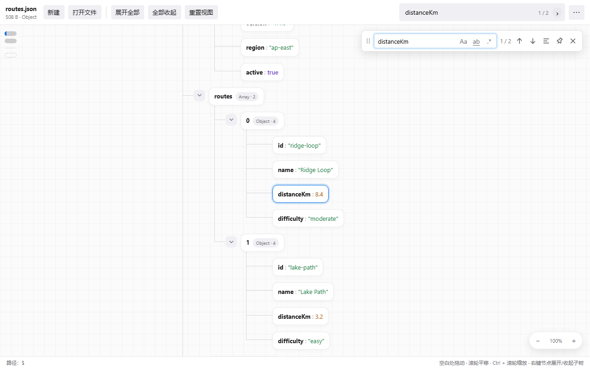

# JSON Atlas

[English](../README.md) · [简体中文](README.zh-CN.md) · [日本語](README.ja.md) · [Español](README.es.md) · [Français](README.fr.md)

**Explora JSON y JSONL nivel por nivel en un árbol interactivo.**

JSON Atlas es una aplicación gratuita y de código abierto para leer y editar archivos locales JSON, JSONL y NDJSON. Despliega respuestas de API y configuraciones, busca claves o valores y edita el código fuente en la vista IDE. El análisis, la indexación y la búsqueda se realizan en tu dispositivo.

[Sitio del proyecto](https://the-cute-cat.github.io/json-atlas/) · [Probar en el navegador](https://the-cute-cat.github.io/json-atlas/app.html) · [Descargar para Windows](https://github.com/The-cute-cat/json-atlas/releases) · [Informar de un problema](https://github.com/The-cute-cat/json-atlas/issues/new/choose)

## Instalación

Para Windows 10 y 11 de 64 bits, elige el instalador EXE o MSI. Se requiere Microsoft Edge WebView2. También hay un paquete portátil y una versión para el navegador. La versión de un solo archivo HTML funciona sin conexión. Consulta la [guía de instalación](../README.md#install) para ver los detalles de Windows y de la versión preliminar para equipos Apple Silicon con macOS 15 o posterior.

La interfaz está actualmente en chino simplificado. En la aplicación de escritorio, abre la configuración desde **Ver → Configuración** (`查看 → 设置…`). Usa **Archivo → Guardar** (`文件 → 保存`) o **Guardar como** (`另存为…`) y **Ver → Buscar** (`查看 → 查找…`).

## Primeros pasos

1. Arrastra un archivo o ábrelo con Ctrl/⌘+O. Los archivos JSONL se abren como registros por línea.
2. Pulsa la flecha junto a un nodo para desplegarlo. Arrastra el fondo o usa la rueda para desplazarte. Mantén pulsada Ctrl/⌘ mientras giras la rueda para ajustar el zoom. Cambia de archivo desde la barra lateral.
3. Pulsa Ctrl/⌘+F para abrir la búsqueda avanzada. Puedes distinguir mayúsculas y minúsculas, buscar palabras completas, usar expresiones regulares o limitar la búsqueda a la rama seleccionada.
4. Pulsa Ctrl/⌘+N para crear un JSON vacío. Selecciona un objeto o un arreglo y pulsa **+** para añadir un nodo hijo o un elemento. Los cambios aplicados a los nuevos documentos se guardan como borradores y se pueden recuperar al reiniciar.

## Edición y guardado

Usa el menú contextual del árbol para editar valores y copiar contenidos o rutas. Las plantillas permiten reutilizar las reglas de visibilidad y el estado de expansión. La vista IDE permite editar el texto con números de línea, resaltado de sintaxis y plegado de código. Usa Ctrl/⌘+Z para deshacer y Ctrl/⌘+Shift+Z para rehacer.

Guarda con Ctrl/⌘+S o guarda una copia con Ctrl/⌘+Shift+S. En el escritorio, si el archivo original cambió en disco, puedes conservar tus cambios guardándolos en otro archivo. Al editar JSONL en el árbol se exportan los registros válidos. Usa **Guardar como** para conservar el archivo original si se omitieron líneas al abrirlo.

## Archivos grandes

En **Configuración → Rendimiento y memoria → Umbral para archivos grandes** (`设置 → 性能与内存 → 大文件处理阈值`) puedes ajustar el umbral. El umbral es configurable y admite 32, 64, 128 o 256 MB. El valor predeterminado es 64 MB. Los archivos que no superan el umbral se procesan en memoria. Por encima del umbral, la aplicación de escritorio crea un índice en disco y carga los datos por páginas en modo de solo lectura. La versión del navegador rechaza esos archivos.

Consulta la [guía de archivos grandes](guides/large-files.md) (en inglés) para reutilizar índices y gestionar la memoria.

## Desarrollo y licencia

Para desarrollar la versión web, ejecuta `npm ci` y después `npm run dev`. La [guía de contribución](../CONTRIBUTING.md) describe cómo preparar y probar la versión de escritorio. Consulta el [registro de cambios](../CHANGELOG.md) para conocer las novedades.

Distribuido bajo la licencia [Apache-2.0](../LICENSE).
