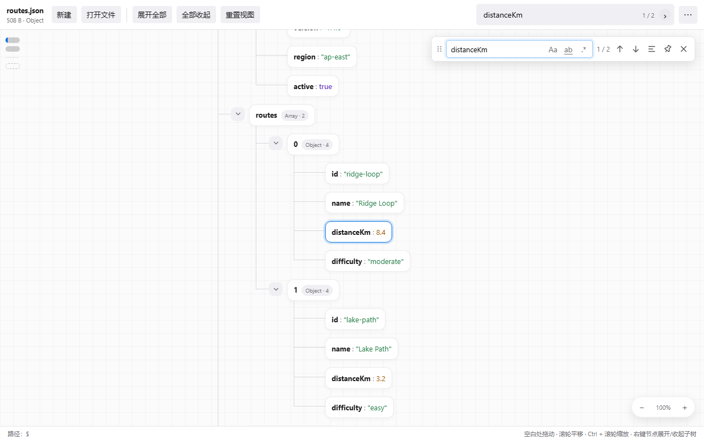

# JSON Atlas

[English](../README.md) · [简体中文](README.zh-CN.md) · [日本語](README.ja.md) · [Español](README.es.md) · [Français](README.fr.md)

**Explorez JSON et JSONL niveau par niveau dans une arborescence interactive.**

JSON Atlas est une application libre et gratuite qui lit et modifie des fichiers locaux JSON, JSONL et NDJSON. Développez des réponses d’API et des fichiers de configuration, recherchez des clés ou des valeurs et modifiez le texte source dans la vue IDE. L’analyse, l’indexation et la recherche s’exécutent sur votre appareil.

[Site du projet](https://the-cute-cat.github.io/json-atlas/) · [Essayer dans le navigateur](https://the-cute-cat.github.io/json-atlas/app.html) · [Télécharger pour Windows](https://github.com/The-cute-cat/json-atlas/releases) · [Signaler un problème](https://github.com/The-cute-cat/json-atlas/issues/new/choose)

## Installation

Sous Windows 10 et 11 en 64 bits, choisissez le programme d’installation EXE ou MSI. Microsoft Edge WebView2 est requis. Une version portable et une version navigateur sont également disponibles. Le fichier HTML autonome fonctionne hors ligne. Le [guide d’installation](../README.md#install) détaille les options Windows et la préversion destinée aux Mac équipés d’une puce Apple sous macOS 15 ou ultérieur.

L’interface est actuellement en chinois simplifié. Dans l’application de bureau, ouvrez les paramètres via **Affichage → Paramètres** (`查看 → 设置…`). Utilisez **Fichier → Enregistrer** (`文件 → 保存`) ou **Enregistrer sous** (`另存为…`), et **Affichage → Rechercher** (`查看 → 查找…`).

## Prise en main

1. Déposez un fichier dans l’application ou ouvrez-le avec Ctrl/⌘+O. Les fichiers JSONL s’ouvrent à raison d’un enregistrement par ligne.
2. Cliquez sur la flèche à côté d’un nœud pour le développer. Faites glisser le fond ou utilisez la molette pour vous déplacer. Maintenez Ctrl/⌘ en utilisant la molette pour zoomer. Changez de fichier dans la barre latérale.
3. Appuyez sur Ctrl/⌘+F pour ouvrir la recherche avancée. Ses options couvrent le respect de la casse, les mots entiers, les expressions régulières et la recherche limitée à la branche sélectionnée.
4. Appuyez sur Ctrl/⌘+N pour créer un document JSON vide. Sélectionnez un objet ou un tableau et cliquez sur **+** pour ajouter un enfant ou un élément. Les modifications appliquées dans les nouveaux documents sont conservées comme brouillons et peuvent être récupérées au redémarrage.

## Modification et enregistrement

Le menu contextuel de l’arborescence permet de modifier une valeur ou de copier un contenu ou un chemin. Les modèles permettent de réutiliser les règles de visibilité et l’état de l’arborescence. La vue IDE offre la numérotation des lignes, la coloration syntaxique et le repli du code. Appuyez sur Ctrl/⌘+Z pour annuler ou sur Ctrl/⌘+Shift+Z pour rétablir une modification.

Enregistrez avec Ctrl/⌘+S ou enregistrez une copie avec Ctrl/⌘+Shift+S. Si le fichier d’origine a changé sur le disque, la version de bureau permet de conserver vos modifications dans un autre fichier. L’édition de JSONL dans l’arborescence exporte les enregistrements valides. Utilisez **Enregistrer sous** pour conserver le fichier original lorsque des lignes ont été ignorées à l’ouverture.

## Fichiers volumineux

Réglez le seuil dans **Paramètres → Performances et mémoire → Seuil des fichiers volumineux** (`设置 → 性能与内存 → 大文件处理阈值`).

Le seuil est réglable sur 32, 64, 128 ou 256 Mo. La valeur par défaut est de 64 Mo. Jusqu’à ce seuil, les fichiers sont traités en mémoire. Au-delà, l’application de bureau construit un index sur disque et charge les données par pages en lecture seule. La version navigateur refuse d’ouvrir ces fichiers.

Consultez le [guide des fichiers volumineux](guides/large-files.md) (en anglais) pour réutiliser les index et gérer la mémoire.

## Développement et licence

Pour travailler sur la version web, exécutez `npm ci`, puis `npm run dev`. Le [guide de contribution](../CONTRIBUTING.md) décrit la configuration et les tests de l’application de bureau. Les nouveautés figurent dans le [journal des modifications](../CHANGELOG.md).

JSON Atlas est distribué sous licence [Apache-2.0](../LICENSE).
