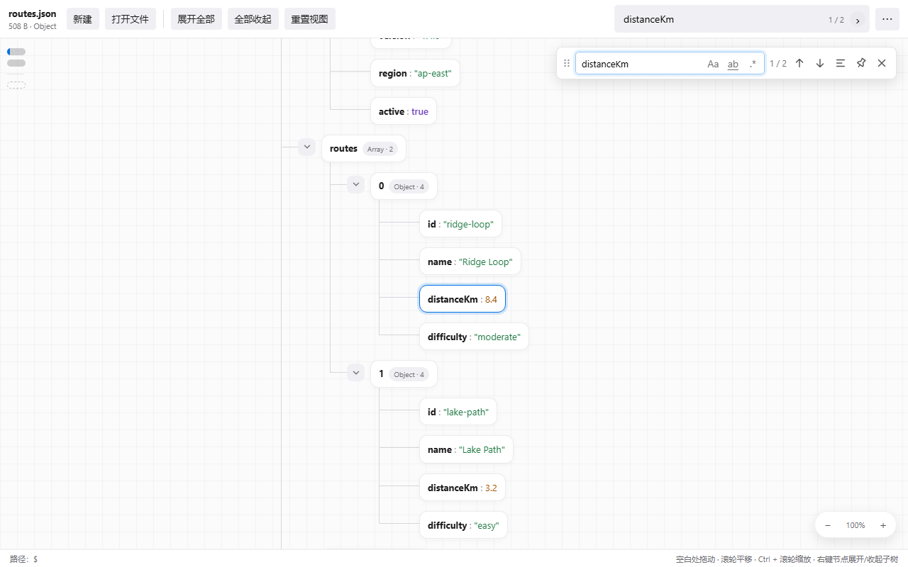

# JSON Atlas

[English](../README.md) · [简体中文](README.zh-CN.md) · [日本語](README.ja.md) · [Español](README.es.md) · [Français](README.fr.md)

**JSON と JSONL を、操作できるツリーで一階層ずつ確認できます。**

JSON Atlas は、ローカルの JSON、JSONL、NDJSON ファイルを閲覧・編集するオープンソースアプリです。API レスポンスや設定ファイルを展開し、キーや値を検索できます。解析・索引作成・検索は端末内で行われます。

[プロジェクトサイト](https://the-cute-cat.github.io/json-atlas/) · [ブラウザーで試す](https://the-cute-cat.github.io/json-atlas/app.html) · [Windows 版をダウンロード](https://github.com/The-cute-cat/json-atlas/releases/latest) · [問題を報告](https://github.com/The-cute-cat/json-atlas/issues)

## インストール

Windows 10 / 11（64 ビット）では EXE または MSI を選べます。Microsoft Edge WebView2 が必要です。ポータブル版や、インストールせずに使えるブラウザー版もあります。単一 HTML 版はオフラインで動作します。Apple シリコンと macOS 15 以降向けのプレビューについては、[インストール手順](../README.md#install)を参照してください。

## 使い方

1. ファイルをドラッグするか、Ctrl/⌘+O で開きます。JSONL は一行ずつレコードとして読み込まれます。
2. ノードの横にある矢印で展開します。背景をドラッグするかスクロールすると移動し、Ctrl/⌘ を押しながらスクロールすると拡大・縮小します。複数のファイルはサイドバーで切り替えます。
3. Ctrl/⌘+F で詳細検索を開きます。大文字・小文字の区別、単語全体、正規表現、選択した枝に限定した検索を利用できます。
4. Ctrl/⌘+N で空の JSON を作成します。オブジェクトや配列を選んで **＋** を押すと子ノードや要素を追加できます。新規文書に適用した編集は下書きに保存され、再起動後に復元できます。

## 編集と保存

ツリーの右クリックメニューから値を編集し、内容やパスをコピーできます。テンプレートで表示フィールドや展開状態を再利用できます。IDE ビューでは、行番号、構文ハイライト、折りたたみを使いながらテキストを編集できます。Ctrl/⌘+Z で元に戻し、Ctrl/⌘+Shift+Z でやり直します。

Ctrl/⌘+S で保存し、Ctrl/⌘+Shift+S で別名保存します。デスクトップ版で元ファイルの外部変更が検出された場合は、変更を別ファイルに保存できます。JSONL のツリー編集で出力されるのは有効なレコードです。読み込み時にスキップされた行を元ファイルに残すには、別名保存を使用してください。

## 大きなファイル

しきい値は 32、64、128、256 MB から選べます。初期値は 64 MB です。しきい値以下ではメモリで処理します。デスクトップ版はしきい値を超えるファイルにディスク索引を作成し、読み取り専用でページ単位に表示します。ブラウザー版はしきい値を超えるファイルを開けません。

## 開発とライセンス

ブラウザー版の開発は `npm ci` と `npm run dev` で始められます。デスクトップ版の準備とテストは[コントリビューションガイド](../CONTRIBUTING.md)、更新内容は[変更履歴](../CHANGELOG.md)を参照してください。

ライセンスは [Apache-2.0](../LICENSE) です。
